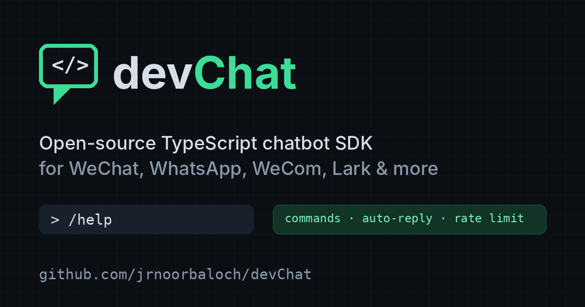

<!-- markdownlint-disable MD033 MD041 -->
<p align="center">
  
</p>

<h1 align="center">devChat</h1>

<p align="center">
  <b>Open-source TypeScript chatbot SDK and bot framework for Node.js.</b><br>
  Build bots for WeChat, WhatsApp, WeCom, Lark and more with one API, plus built-in slash commands, auto-replies and rate limiting.
</p>

<p align="center">
  <a href="https://devchat-docs.vercel.app"><b>Documentation</b></a> ·
  <a href="https://devchat-docs.vercel.app/getting-started">Getting started</a> ·
  <a href="https://devchat-docs.vercel.app/plugins">Plugins</a> ·
  <a href="https://devchat-docs.vercel.app/api">API</a>
</p>

<p align="center">
  <a href="https://github.com/jrnoorbaloch/devChat/actions/workflows/node.js.yml"></a>
  <a href="LICENSE"></a>
  
  = 26">
</p>

---

## What is devChat?

**devChat** is a developer-first **chatbot SDK** and **RPA (robotic process automation) framework** written in **TypeScript**. You write your bot logic once, against one clean API. Then you choose which messenger it runs on (WeChat, WhatsApp, WeCom/WXWork, Lark/Feishu, QQ, Gitter and more) by changing a single setting.

devChat is a fork of the popular [Wechaty](https://github.com/wechaty/wechaty) project and stays API-compatible with it. On top of Wechaty's core it adds the pieces almost every bot ends up writing by hand:

- 🧭 **`CommandRouter`**: `/slash` commands with quoted arguments, aliases, an automatic `/help`, and error isolation.
- 💬 **`AutoReply`**: declarative keyword, RegExp and function rules for FAQ, support and greeter bots.
- 🚦 **`RateLimiter`**: per-user sliding-window throttling that protects your bot account from floods and bans.
- ⚙️ **`DEVCHAT_*` environment variables**, with full backward compatibility for `WECHATY_*`.
- 🏷️ **`DevChatBuilder` / `DevChat` / `DevChatPlugin`** brand names. Every `Wechaty*` export still works.

## Quick start

Requirements: **Node.js 26+** and **npm 10+**.

```sh
git clone https://github.com/jrnoorbaloch/devChat.git
cd devChat
npm install
npm run demo:commands   # scan the QR code, then send /help to your bot
```

## A useful bot in 20 lines

```ts
import { DevChatBuilder, CommandRouter, AutoReply } from 'devchat'

const bot = DevChatBuilder.build({ name: 'my-bot' })

bot.use(
  CommandRouter({
    commands: {
      ping: () => 'pong',
      echo: { description: 'Repeat text', aliases: ['say'], handler: ({ rawArgs }) => rawArgs },
    },
    rateLimit: { limit: 10, intervalMs: 60_000 },
    requireMentionInRoom: true,
  }),
  AutoReply({
    rules: [
      { match: 'hi', reply: 'Hello! 👋 Type /help' },
      { match: /weather in (\w+)/i, reply: (_msg, m) => `Checking weather for ${m?.[1]}…` },
    ],
  }),
)

bot.on('scan', qrcode => console.log('Scan to log in:', qrcode))
await bot.start()
```

Run it with your messenger of choice:

```sh
DEVCHAT_PUPPET=wechaty-puppet-whatsapp node bot.ts
```

## Supported messengers

devChat connects to messengers through interchangeable **puppet providers**:

| Messenger | Puppet |
| --- | --- |
| WeChat (default, web protocol) | `wechaty-puppet-wechat4u` |
| WeChat (browser / iPad) | `wechaty-puppet-wechat`, `wechaty-puppet-padlocal` |
| WhatsApp | `wechaty-puppet-whatsapp` |
| Lark / Feishu | `wechaty-puppet-lark` |
| QQ | `wechaty-puppet-oicq` |
| Gitter | `wechaty-puppet-gitter` |
| WeChat Official Account | `wechaty-puppet-official-account` |
| Remote service / testing | `wechaty-puppet-service`, `wechaty-puppet-mock` |

## Documentation

The full documentation lives at **<https://devchat-docs.vercel.app>**:

- [Getting started](https://devchat-docs.vercel.app/getting-started): install the SDK, run your first bot, and learn the bot lifecycle
- [Built-in plugins](https://devchat-docs.vercel.app/plugins): `CommandRouter`, `AutoReply`, `RateLimiter`, and writing your own plugin
- [Configuration](https://devchat-docs.vercel.app/configuration): environment variables, puppets and Docker
- [API reference](https://devchat-docs.vercel.app/api): the bot, events, `Message`, `Contact` and `Room`
- [Migrating from Wechaty](https://devchat-docs.vercel.app/migration)
- [FAQ](https://devchat-docs.vercel.app/faq)

The site source is in [`website/`](website/). Build it with `node website/build.mjs`.

## Development

```sh
npm install
npm test            # lint + typecheck + unit tests
npm run test:unit   # unit tests only (node:test)
npm run dist        # compile to dist/
```

The project layout:

```text
src/            SDK source (TypeScript, run directly by Node.js)
src/plugins/    devChat built-in plugins: CommandRouter, AutoReply, RateLimiter
bin/            CLI: devchat, devchat-doctor, devchat-version, ...
examples/       ding-dong-bot.ts, command-bot.ts
website/        documentation site (static, deployed to Vercel)
```

See [DEVELOPMENT.md](DEVELOPMENT.md) and [CONTRIBUTING.md](CONTRIBUTING.md) for details.

## Contributing

Issues and pull requests are welcome! Please run `npm test` before opening a PR. If you like the project, a ⭐ helps others find it.

## License and credits

devChat is licensed under the [Apache License 2.0](LICENSE).

devChat is a fork of **[Wechaty](https://github.com/wechaty/wechaty)**, created by [Huan Li](https://github.com/huan) and the Wechaty community. All original copyright notices are kept, and the [NOTICE](NOTICE) file records the attribution. Thank you to every Wechaty contributor. The full upstream history is in [CHANGELOG.md](CHANGELOG.md).

---

**Keywords:** chatbot SDK, TypeScript chatbot framework, Node.js bot framework, WeChat bot, WhatsApp bot, WeCom bot, Lark bot, RPA, conversational AI, slash commands, auto reply bot, rate limiter, Wechaty alternative.
